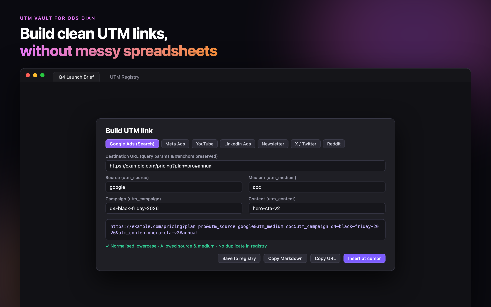
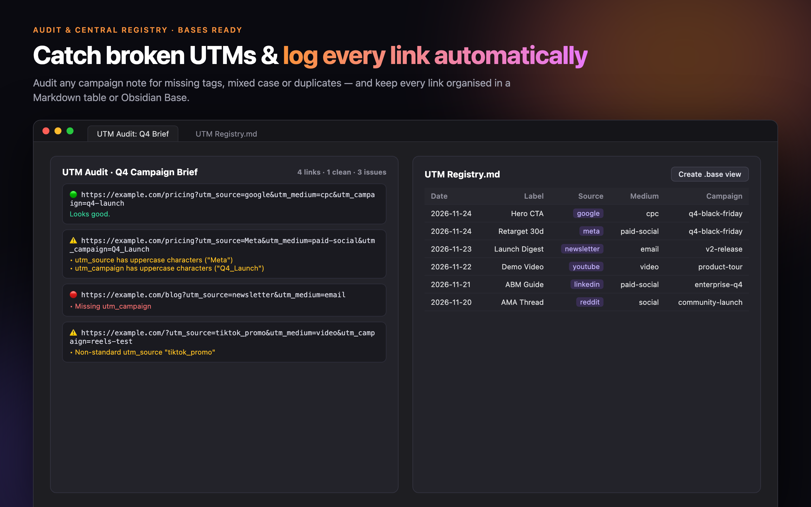

# UTM Vault

> ⭐ If UTM Vault saves you time, a star helps other marketers find it. Found a bug or have an idea? [Open an issue](https://github.com/chi-li-peppers/obsidian-utm-vault/issues).

Build, normalise, validate and organise UTM tracking links right inside Obsidian — no messy spreadsheets required.

## Features

- **Channel presets**: one-click presets for Google Ads, Meta Ads, YouTube, LinkedIn, Newsletter, X, Reddit and Affiliate (fully editable in settings)
- **Strict normalisation**: automatic lowercase, space-to-hyphen/underscore conversion, preserving existing query parameters and `#hash` fragments without duplicating UTM tags
- **Live validation & duplicate detection**: warns on missing required tags, non-standard sources/mediums, or links already in your registry
- **Markdown registry**: automatically logs every created link in a clean Markdown table (`UTM Registry.md`)
- **Obsidian Bases mode**: optionally creates one note per UTM link with YAML properties (`utm_source`, `utm_medium`, `utm_campaign`, `utm_url`…) and includes a one-click command to generate a ready-to-use `.base` view
- **Note UTM audit**: scan any campaign brief or note for broken, inconsistent or duplicate UTM links
- **Clipboard parser**: parse and edit any existing UTM URL straight from your clipboard
- **Works on mobile** & zero external dependencies

## Audit & Registry

## Commands

| Command | What it does |
| --- | --- |
| Build UTM link | Opens the interactive UTM builder modal |
| Insert UTM link at cursor | Builds a UTM link and inserts it into the active note |
| Parse and edit UTM link from clipboard | Pre-fills the builder from a URL in your clipboard |
| Audit UTM links in current note | Checks all UTM URLs in the open note for errors and inconsistencies |
| Open UTM registry | Opens (or creates) your Markdown UTM registry table |
| Create Obsidian Base view (.base) for UTM links | Generates a `.base` table view for your UTM notes folder |

## Privacy

UTM Vault makes **zero network requests**. Everything stays locally in your vault.

## Install

Search for **UTM Vault** in **Settings → Community plugins**, or install manually by copying `main.js`, `manifest.json` and `styles.css` from the [latest release](../../releases/latest) to `<vault>/.obsidian/plugins/utm-vault/` and enabling the plugin.

## More Obsidian plugins & themes

- **[Ad Recap](https://github.com/chi-li-peppers/obsidian-ad-recap)** — Google Ads & Meta Ads metrics in your notes
- **[Traffic Recap](https://github.com/chi-li-peppers/obsidian-traffic-recap)** — GA4, Search Console, Plausible & PostHog metrics in your notes
- **[Bases Conditional Format](https://github.com/chi-li-peppers/obsidian-bases-conditional-format)** — colour badges, row highlights and progress bars for Obsidian Bases
- **[Chili](https://github.com/chi-li-peppers/obsidian-chili)** & **[Popcorn](https://github.com/chi-li-peppers/obsidian-popcorn)** — Obsidian themes

## License

[MIT](LICENSE) © 2026 David ([chi-li-peppers](https://github.com/chi-li-peppers))
